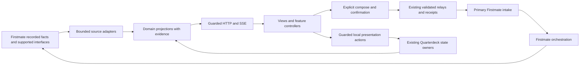

# Quarterdeck architecture and ownership

The proposed architecture keeps the current Node server and vanilla browser client as one application with explicit internal boundaries. The refactoring should make source interpretation, domain rules, delivery and presentation independently understandable while retaining their existing contracts. A framework change, database, service split or generic workflow engine is unnecessary for this goal.

The [product requirements](PRODUCT.md) define the outcomes. This document proposes structural boundaries; [current architecture](../ARCHITECTURE.md) and the detailed domain contracts describe shipped behavior. The accepted [S00 composition](S00-BASELINE.md) includes the landed receipt/cycle, same-part context and ledger-closure foundations. [S01 reconciliation](S01-DOC-OWNERS.md) qualifies the immutable historical snapshot; module boundaries below remain proposed.

The [reconciled review](../product/DECISIONS.md#summary) adds a deliberate desired change: raw drafts survive automatic updates of the edited card but not user-driven departure/reload. Keep that behavior change separate from structural extraction and from durable sent/uncertain receipt recovery. Firstmate-owned free-text interpretation and corresponding mate/type checkboxes likewise describe desired behavior, not an already changed adapter.

## Current structure and pressure points

The codebase already has useful modules: bounded history readers, transcript adapters, work projection, call transport/patching, answer and thread relays, receipt handling, quota readers and several pure browser view models. Preserve and compose these seams rather than rebuilding them.

| Area | Evidence in current source | Structural problem to address |
| --- | --- | --- |
| Server composition | [server.js](../../prototype/server.js) implements `loadFirstmateHome`, record ingestion/routing, expense rollups, dashboard composition and HTTP dispatch | Source policy, projection and transport change together; move one cohesive responsibility at a time behind the current exported functions. |
| Browser composition | [app.js](../../prototype/public/app.js) contains chat navigation/rendering, Work Split, finance views, refresh state and call-controller wiring | Shared mutable variables obscure ownership and cleanup. Extract feature controllers with explicit inputs and lifecycle. |
| Composer coordination | [review-client.js](../../prototype/public/review-client.js) uses tab-local queues, immutable captures, `window.quarterdeckCallQueue`, target bindings and events | Queueing, receipt recovery, target capture and layout need named boundaries without creating another sender. |
| Call interpretation | [answered-calls.js](../../prototype/answered-calls.js), [bearings-thread.js](../../prototype/bearings-thread.js), answer status and [call-lifecycle.js](../../prototype/public/call-lifecycle.js) interpret related receipt facts | PR 112 supplies shared server receipt/cycle attribution. Preserve that seam and compare browser parity; do not create a second lifecycle owner. |
| Chat-ask matching | [chat-asks.js](../../prototype/chat-asks.js) combines source cursors, extraction, linking, tombstones and composition | These have different change risks. Keep exact grammar shared with the existing browser parser; separate orchestration from pure matching only when behavior can be held constant. |
| Documentation | Root README, architecture, feature plan and detailed contracts repeat some status and behavior descriptions | Establish canonical owners and short summaries. Resolve drift before moving the implementation it describes. |

These are maintainability findings from source structure, not claims of reproduced runtime defects. The existing modules and extensive regression suites make gradual extraction practical.

## Data and communication flow

The selected task, fleet or record travels as context. It never selects a crew endpoint. Child-home evidence and second-mate records remain observations through their established contracts; their presence does not authorize remote-home discovery or direct delivery.

## Proposed module responsibilities

| Boundary | Owns | Existing starting points | May depend on |
| --- | --- | --- | --- |
| Runtime composition | Startup configuration, construction, shutdown and dependency wiring | `server.js:createServer`; browser startup in `app.js` | All application components, through explicit interfaces |
| HTTP mediation | Routes, bounded parsing, common origin/revision checks, status mapping and static assets | Dispatch in `server.js`, `revision.js`, `git-identity.js` | Application services and existing guard primitives |
| Firstmate adapters | Confined files/commands, native formats, source identity and coverage | `history-reader.js`, transcript adapters, `firstmate-records.js`, `secondmate-messages.js`, activity reader | Small filesystem/process utilities and exact parsers |
| Conversation projection | Message normalization, route projections, mirror deduplication, source selection and windows | Conversation functions in `server.js`, `lane-payload.js`, `authorship.js` | Adapters and pure routing/provenance rules |
| Work projection | Explicit taxonomy, execution/pressure facts, completion and delivery evidence | `work-model.js`, work composition in `server.js` | Firstmate facts, the taxonomy owner, bounded durability probes |
| Attention projection | Filed calls, linked chat asks, landed/underway/charted rows and receipt enrichment | `bearings.js`, `chat-asks.js`, `answered-calls.js`, accepted `receipt-provenance.js` | Authoritative adapters, existing local state, read-only receipts |
| Intent delivery | Schema-specific answer/thread/review/chat validation, durable captures and idempotent intake | Existing relays, `review.js`, `review-v2.js`, `inbox.js`, `inbox-batcher.js` | Existing receipt/outbox owners and primary intake adapters |
| Supporting domains | Ledger/cost projection, quota evidence, preference display and health settings | Pure expense functions in `server.js`, `costs.js`, `quota.js`, preference modules | Their own allowlisted adapters and state owners |
| Browser features | Rendering, local interaction state and feature-specific refresh/disposal | Existing call controllers and view models; extract remaining chat/work/finance features | API client, pure domain/view helpers and shell interfaces |
| Shell and compose | Routing, panel layout, accessible focus, context capture, queue/retry UI and feature coordination | Shell modules, `review-client.js`, target capture modules | Feature interfaces and the existing delivery client |

Proposed folders can follow these boundaries under `prototype/`; folder names are secondary to dependency direction. Keep `prototype/server.js` as the entry point and compatibility exports while consumers move. Moving it or renaming `prototype/` would also affect source identity, receipt defaults, installed pins and tooling; defer that cleanup.

## Dependency rules

1. Domain projections consume validated facts and explicit state inputs. They do not read HTTP requests, query the DOM or choose recipients.
2. Adapters own native source formats and confinement. A projection cannot broaden source discovery to satisfy a UI requirement.
3. HTTP dispatch invokes domain services; extracting route helpers must preserve each schema's stricter policy. One common JSON helper is not a common authorization policy.
4. Browser controllers receive dependencies at construction and provide named operations plus `dispose`. Event subscriptions, timers and pending requests have one lifecycle owner.
5. The shell wires features; features do not reach into another feature's mutable internals. Replace individual `window` bridges incrementally with injected interfaces, retaining compatibility shims during the transition.
6. Shared helpers are justified by identical semantics, not similar code. Keep schema-specific validators, clock precedence and unknown-state policies in their domains.
7. No refactoring slice creates a new fleet lifecycle, sender, primary destination or decision store.

A proposed browser interface may expose `callQueue.list/remove/send` and `messageTargets.resolve`, with the existing implementations behind them. The interface must preserve the current send cutoff, immutable captured request and exact DOM/record lifetime checks. It does not grant a target descriptor delivery authority.

## Evidence and identity contracts

Preserve these dimensions in each domain rather than compressing them into one global status enum:

| Dimension | Meaning and owner |
| --- | --- |
| Source and record identity | Native record IDs or documented byte-offset identity; adapter-owned |
| Entity and occurrence identity | Scoped task/card key, hold cycle or completion fingerprint; domain-owned |
| Presentation revision | Reviewed card/model content revision; distinct from occurrence identity and startup code revision |
| Serving revision | The clean startup Git commit, proven by the existing revision guard |
| Observation clocks | Source event time, successful observation and last attempt; never substitute one for another |
| Availability and freshness | Ready/loading/stale/unavailable according to that domain's contract |
| Coverage | Selected sources, windows, omitted records and unmeasured homes; partial coverage can coexist with fresh data |
| Authorship | Verified Quarterdeck send or supported unverified-input category; visibility is independent |
| Association | Exact individual request, combined submission, earlier cycle or task-only context |
| Delivery and resolution | Request receipt posture versus authoritative source closure or deployment |

This is a design checklist for existing/additive models, not a mandate to migrate every API to a universal evidence schema. Missing fields retain existing conservative compatibility behavior. Public output continues to redact private paths and sensitive detail.

For the accepted receipt/cycle foundation, preserve `holdVersion` precedence over presentation `cardRev` in the established consumers. Cosmetic changes can update `rev` without creating another cycle. A new recorded reason or hold clock changes the occurrence and excludes older-cycle locks. Preserve shared-reply membership without attributing its body to individual cards. Keep historical-answer admission default-disabled and separated from ordinary transcript input.

## State ownership

One semantic owner per state class is the rule. It does not mean one new global file: the application already has several deliberate owners with different durability requirements.

| State class | Existing owner | Refactoring constraint |
| --- | --- | --- |
| Fleet tasks, holds and native transcript records | Firstmate home and its supported producers | Read through contracts; do not write inferred corrections into these records. |
| Taxonomy and exact completion acknowledgements/bindings | `agent-state.js`, configured state path | Preserve schemas, fingerprints, locking and external-home ownership guard. |
| Chat cursors, asks and tombstones | `chat-asks.js`, sibling chat-asks file | Preserve accepted resolutions and cursor-repair semantics; no parallel lifecycle store. |
| Parking and landed acknowledgements | Existing procrastination and landed-ack stores | Preserve scoped keys, readable-size bounds and local-only meaning. |
| Review receipts and combined inbox outbox | `review.js` and `inbox-batcher.js` | Preserve request/batch/item membership and original durable bytes. Review receipts currently retain a checkout-owned default. |
| Raw drafts, captured retries, filters and disclosure choices | Existing browser session/local storage and controller memory | Structural moves preserve current owners and legacy names. The separately specified D04 change removes raw-draft restoration on user-driven departures/reloads; durable history and sending/uncertain captures remain distinct owners/lifetimes. |
| Quota/billing/snapshot caches | Respective in-process readers | Preserve coalescing, failed-read behavior, TTL meaning and shutdown. |
| Health preferences and push state/keys | Existing health and notification owners | Preserve enablement, private ownership and removal contracts. |
| Expense ledger and attribution | Selected private overlay or documented fallback | No merge of billing and ledger, currency conversion or source cleanup migration. |

Extracting persistence mechanics must not homogenize their guarantees. A common atomic-write utility can be proposed only after documenting each caller's lock, validation, recovery and failure behavior. Busy or abandoned locks are not stolen as part of refactoring.

## Action boundaries

| Action family | Effect and retained boundary |
| --- | --- |
| Review, primary chat, call answer and card thread | Existing schema-specific communication to primary Firstmate; explicit captain intent, exact revision/origin checks and durable request identity |
| Inbox send-now | Flushes already accepted outbox items; does not create fresh intent or change recipients |
| Work classification, Mark understood, chat dismissal, parking and landed acknowledgement | Their exact Quarterdeck state owners; no task resolution, merge or deployment |
| Health settings and notification enrollment/disable | Existing bounded private setting/device contracts; no general preference editor |
| Preview selection | Chooses an allowlisted pre-provisioned runtime; never creates checkouts, arbitrary refs or worker processes |

The runtime still requires Linux/WSL and the documented Node 24 validation baseline, explicit home selection and trusted private access. Keep startup commit pinning, origin restrictions, read limits and installed integration inventory/uninstall/toolcheck intact. This decomposition does not broaden platform support or add authentication.

## Documentation decisions

| ID | Proposed decision | Reason and revisit trigger |
| --- | --- | --- |
| A01 | Keep one application and the existing runtime stack | Internal ownership is the problem. Revisit a service split only with an independently deployable responsibility and measured need. |
| A02 | Extract existing domain seams before adding abstractions | Preserves proven guards and behavior. Revisit shared machinery after two consumers demonstrate identical semantics. |
| A03 | Keep native facts, local choices and delivery receipts separate | Each has a different authority and durability owner. Any migration needs its own preservation/rollback contract. |
| A04 | Use explicit feature interfaces instead of growing global coordination | Makes dependency and cleanup visible. Retain temporary bridges until behavioral equivalence is proven. |
| A05 | Retain exact domain contracts as canonical documentation | Avoids another layer of duplicated rules. Summaries link to their owner and distinguish shipped from pending behavior. |

Record an accepted behavior change in its existing domain contract and update these decisions when their tradeoffs change. A separate decision record is warranted for a new source, authority path, state owner or irreversible compatibility choice, not for every file move.
