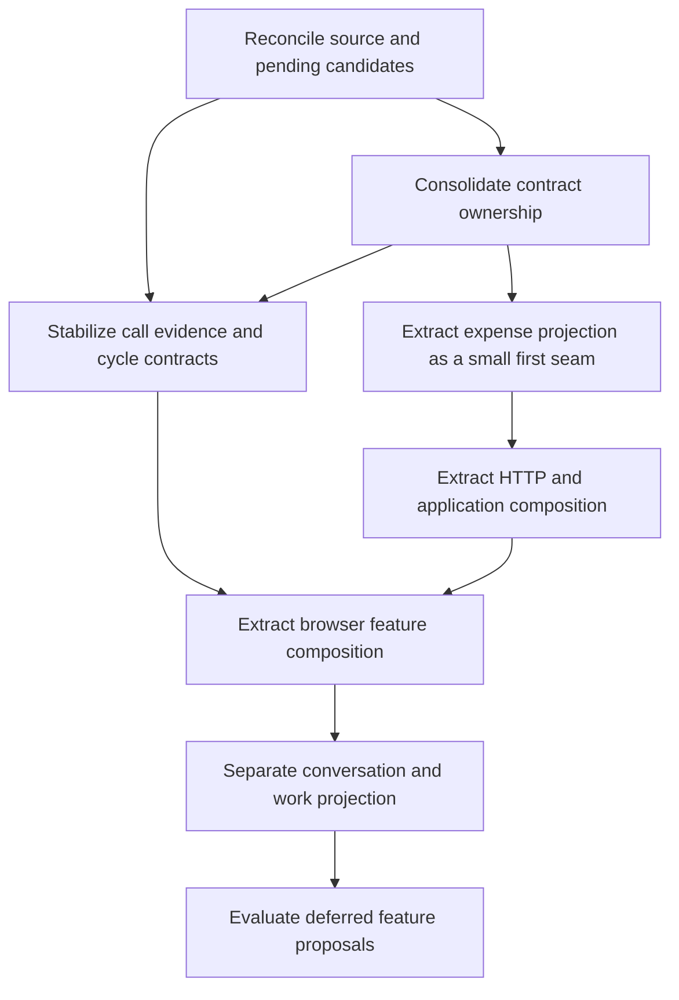

# Quarterdeck refactoring plan

Refactor by extracting a responsibility while preserving its observable behavior and authority. Each slice should have one user outcome, one semantic owner, focused validation and an independent rollback. Feature repairs, source-contract changes and state migrations are separately scoped changes, even when they touch the same files.

The [product requirements](PRODUCT.md), [architecture](ARCHITECTURE.md) and [intent map](INTENT-MAP.md) form the intake. The plan is a proposed sequence, not a request to implement every slice or an estimate of effort.

[S00 source baseline](S00-BASELINE.md) records the accepted main composition for the separate `auto-refactor` lane and qualifies the historical specification snapshot. Its tracking issue owns actual validation/delivery status; later slices remain unstarted.

Use the [reconciled answers](../product/DECISIONS.md#summary) to distinguish preservation from desired behavior changes. D04 intentionally changes raw-draft recovery; D01 requires neutral free-text semantics; D03 specifies corresponding mate/type controls. Implement those as explicit behavior slices with affected contracts reconciled, rather than letting a structural extraction silently change them. D02 protects composer history and does not settle chat-only call closure.

## Sequence and dependencies



A pending unrelated issue does not block every extraction. Only slices that depend on its exact source, schema, state owner or UI interaction wait for its disposition. Deferred proposals remain deferred throughout structural work.

## Proposed implementation slices

| Slice | Scope and dependency | Completion evidence | Rollback boundary |
| --- | --- | --- | --- |
| S00 Establish the actual baseline | Record accepted source SHA, PR 112 composition disposition and PR 95 interaction status. Compare the main changes listed in the intent map. No speculative refactoring on an assumed combined build. | Exact resulting tree and affected semantic contracts identified; default-disabled capabilities remain disabled; separate checks described accurately. | Source selection only; no data mutation or automatic candidate merge. |
| S01 Consolidate documentation owners | Resolve the documented drift, link repeated summaries to canonical owners, and mark shipped/pending behavior consistently. | README, current architecture, feature plan and detailed contracts agree on supported behavior; single-primary routing is explicit. | Documentation diff only. |
| S02 Extract ledger projection | Move exact cents parsing, rollup and ledger presentation projection out of `server.js`, preserving its public export/import compatibility and overlay selection. | Existing cost/ledger behavior covers decimal arithmetic, negative entries, empty canonical fallback, separate currencies and separate billing. Dashboard output remains equivalent. | Revert extraction; no ledger, state or receipt migration. |
| S03 Separate HTTP mediation and construction | Extract one cohesive route family first, then runtime wiring. Keep `createServer` compatibility and existing guard/order semantics. | Existing HTTP tests prove origin/revision/body-size/schema refusals, expected response shape and clean shutdown for the moved family. | Revert that route-family extraction; all wire/storage names retained. |
| S04 Centralize call evidence projection | After PR 112's integration disposition, retain its existing receipt-provenance seam and make answer status, thread and answered-call consumers use the same evidence rules. Separate pure linking/cycle rules only where equivalence is demonstrable. | Current/older/new cycles, cosmetic revisions, combined replies, unknown clocks, child scope and 118/119 semantics pass meaningful transition checks. | Revert module wiring; preserve original receipts, asks and tombstones. |
| S05 Give browser features explicit ownership | Extract a supporting feature controller first, then chat and call composition. Inject API, clock, storage and queue/target interfaces as needed; retain temporary global bridges. Split composer layout from capture/delivery recovery without creating another sender. | View switches dispose owned subscriptions/timers; one refresh owner remains per domain; preserved focus/drafts/reading position and immutable send cutoff are demonstrated. | Restore previous wiring and entry scripts; no persisted-key rename. |
| S06 Separate conversation and work loading | Extract normalized conversation loading from `loadFirstmateHome`, then work composition. Reuse native adapters, exact route logic and explicit taxonomy. | Source admission, mirror deduplication, projected record IDs, selected history, coverage and completion/delivery meanings remain equivalent. | Keep compatibility façade and unchanged source/state owners. |
| S07 Reassess optional features | Evaluate 45/46/107/109 against confirmed cockpit direction, authoritative data and distinct user benefit. 103/108 retain their own research/product decisions. | A bounded feature contract states the outcome, owner, data gap and acceptance before implementation. | No feature starts solely because this plan lists it. |

S02 is a small demonstration of the architecture, not a prerequisite to every correctness fix. S04 is higher product risk and needs its accepted candidate baseline first. S05 and S06 can be split into smaller PRs by feature/domain; do not move the whole frontend or server in one change.

## Preservation matrix

Use the smallest relevant subset for a slice; broaden when changed dependencies introduce additional risk. Existing suites already cover much of this behavior. Add a regression only for a meaningful gap or changed contract.

| Contract | Representative behavior to preserve | Existing evidence starting point |
| --- | --- | --- |
| Call source and identity | Scoped sibling tasks, stale retention, omissions, no ineligible Merge, canonical key/rev and new occurrence | Bearings, scoped-decision, chat-ask and hold-lifecycle tests; pending PR 112 producer/clarity suites |
| Context and association | Same original text part, sibling bounds, missing context, exact current-cycle exchange and labelled shared provenance | `chat-asks-context.test.js`, bearings thread tests; pending receipt/cycle tests |
| Delivery | No send on queue/cancel/gesture; partial batch acceptance; lost response; same-ID recovery; original provenance | Review, cutoff, inbox/batcher, answer and authorship suites |
| Continuity | Engaged card hold, other cards update, draft stub, selection/focus/scroll and exact record capture after feed replacement | Bearings patch/answer form, UI and isolated browser scenarios; PR 95 remains separately incomplete |
| Work | Conservative execution proof, explicit taxonomy, renewed completion, acknowledgement distinct from delivery | `work-model.test.js`, status/hold and work hierarchy coverage |
| History | Source limits distinct from pages, selected sources and old tasks, omission warnings and saved filters | History-reader/limits/admission, transcript, synthetic history and filter suites |
| Supporting domains | Exact currency arithmetic, separate costs, stale quota evidence, independent refresh and preference ownership | Cost/quota/preference suites and their browser view models |
| Runtime and private owners | Clean startup SHA, moved-HEAD refusal, guarded origins, private overlay, atomic state and preview confinement | Revision/server/private/preview/integration ownership suites |

Compare before/after results from equivalent neutral fixtures, including negative and missing-evidence cases. A screenshot or source-string assertion alone cannot prove a source join, lifecycle transition or durable delivery. Reuse existing behavior tests rather than generating snapshots that merely mirror new implementation structure.

## Validation and delivery

Use the established Linux/WSL, Node 24, Git and synthetic-fixture validation contracts. Documentation-only changes need link, consistency and relevant source-boundary checks. Runtime changes use focused behavior tests plus required repository checks; new test files belong exactly once in the exhaustive [test selection](../../prototype/scripts/test-selection.json).

For interaction changes, use the accepted exact-revision browser workflow and relevant desktop/tablet/phone/keyboard cases. Synthetic viewport checks and physical-device acceptance remain different evidence. Preserve [CI-Q3](../SOURCE-PREVIEW-VALIDATION.md): the entire Latest pass is excluded by default and retained opt-in, never silently treated as passed. A refactor does not repair that issue by moving or weakening assertions.

Record failed checks and their actual disposition. A later pass is evidence for that candidate, not an explanation of an earlier failure. The existing branch, integration, publication and service ownership contracts still govern delivery. This plan supplies implementation scope, not an approval to operate a live service.

## Reusable change brief

Use this brief for a refactoring slice or a feature whose intent is otherwise loose:

For visible controls and layout, include the relevant [implementation entry](../product/implementation/README.md) and source answer from the [design decisions](../product/DECISIONS.md). Use the [registry](../document-map.yaml) to find their intent and rule owners.

```text
User outcome and product requirement:
Human implementation entry IDs and source answer/request:
Why the existing boundary makes this change difficult:
Slice and exact baseline SHA:
Overlapping issues and pending candidate disposition:
Observed behavior to preserve:
Behavior change, if any, explicitly separated from extraction:
Authoritative source and canonical contract:
Entity, occurrence, record and request identities involved:
State owner and compatibility names involved:
Modules to move and allowed dependency direction:
Primary Firstmate communication path, if affected:
Missing or upstream-owned facts:
Acceptance examples, including refusal and unknown cases:
Required tests and interaction evidence:
Rollback and state preservation:
Documentation owner to update:
Remaining product decision or integration prerequisite:
```

A brief that requires guessing the recipient, source identity, lifecycle owner or missing question is not ready for implementation. Resolve that exact uncertainty with the product/source owner; independent structural work can proceed elsewhere.

## Definition of a completed slice

The resulting behavior matches the accepted contract, required checks pass with exclusions reported, one clear owner implements each changed rule, and the current architecture points to the resulting source. Receipt IDs, tombstones, compatibility names and private owners survive. Raw-draft lifetime follows the explicitly scoped slice: unchanged during extraction, or deliberately changed according to D04 with delivery captures protected. The change can be reverted without reconstructing private data.

The overall refactoring succeeds when future requests can be placed in a domain, expressed as a requirement and validated without rediscovering implicit rules across the whole application. It does not require every file to move or every open proposal to be implemented.
